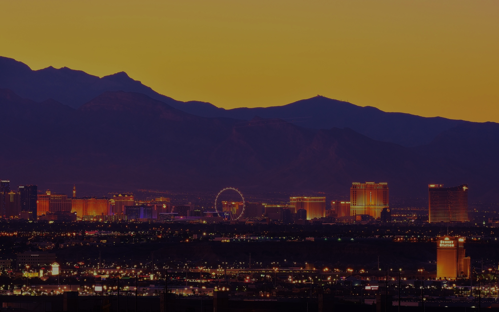

# Vegas Dusk



**Vegas Dusk** is a unified, solid-background dark theme suite for Emacs, COSMIC Desktop, COSMIC Terminal, Firefox, and Google Chrome, derived from the Las Vegas desert skyline at dusk.

**Core Design Constraint:** Strictly solid backgrounds (`#100812` primary base) with `is_frosted: false` and zero gradients.

## Color Engineering: Why Raw *k*-Means Quantization Was Rebalanced

The final perceptual palette was evolved from the raw 16-color quantized output to address specific issues:

1. **Redundant Hue Clusters:** Clustering algorithms optimize for pixel surface area in `assets/vegas_natural_1920x1200.jpg`, producing near-identical ochre golds (`#9D7B2D`, `#9E8233`, `#A08534`) from the sky gradient and near-identical indigos (`#1F1D43`, `#241E42`, `#27234A`) from the mountain shadows that are indistinguishable when assigned to syntax tokens.
2. **Mid-Tone Contrast Collapse:** Against `#100812`, the raw mid-tones (`#96673D` at 3.99:1, `#945921` at 3.45:1, `#644841` at 2.34:1, and `#562420` at 1.54:1) fail the WCAG AA (4.5:1) legibility threshold for body and code text.
3. **Lack of Cool Foreground Accents:** All 8 dark quantized colors were cool purples/maroons and all 8 lighter colors were warm yellows/browns. Sampling smaller photographic details—cool twilight ridge blues (`#7A96B8`), dusk mountain lavender (`#948EC9`), foreground taillight crimson (`#D14D41`), and desert sage (`#8FA86A`)—unlocked full semantic separation for types, constants, errors, and diffs without relying on underline hacks.
4. **Terminal ANSI Luminance Floor:** Raised the luminance floor for the `black` (`30`) column and `dim` (`SGR 2`) ANSI row so TUI borders, faint text, and shell prompts remain legible even when terminal opacity blends with the desktop backdrop.

## Palette Breakdown Tables

### Table 1: Raw Quantized Source Colors (16-Color Reference)

| Hex | Role Context | Adjustment Notes |
|---|---|---|
| `#100812` | Deepest Shadow | Kept as Primary Base |
| `#1F1D43` | Mountain Shadow | Kept for UI Accents |
| `#241930` | Horizon Haze | Kept for UI Backgrounds |
| `#241E42` | Mountain Shadow | Merged / Discarded |
| `#27234A` | Mountain Shadow | Kept for UI Accents |
| `#281B38` | Horizon Haze | Merged / Discarded |
| `#2B1013` | Deep Foreground | Discarded |
| `#562420` | Dark Foreground | Contrast Failed |
| `#644841` | Muted Foreground | Contrast Failed |
| `#945921` | Orange Skyline | Contrast Failed |
| `#96673D` | Bronze Skyline | Contrast Failed |
| `#9D7B2D` | Sky Gradient | Merged |
| `#9E8233` | Sky Gradient | Merged |
| `#A08534` | Sky Gradient | Merged |
| `#A28F60` | Light Cloud | Kept/Adjusted for Tan |
| `#A3998A` | High Cloud | Kept for Dim Foreground |

### Table 2: Rebalanced Core & Semantic Palette

| Role | Token | Hex | RGB | WCAG Contrast (vs #100812) | UI / Syntax Assignment |
|---|---|---|---|---|---|
| Surfaces | `bg-main` | `#100812` | 16, 8, 18 | Base | Default Background |
| Surfaces | `bg-dim` | `#170D1B` | 23, 13, 27 | 1.1:1 | Inactive UI |
| Surfaces | `bg-plum` | `#241930` | 36, 25, 48 | 1.3:1 | Selected / Hover |
| Surfaces | `bg-violet` | `#34254A` | 52, 37, 74 | 1.8:1 | Active Selections |
| Surfaces | `bg-indigo-1` | `#1F1D43` | 31, 29, 67 | 1.4:1 | Focus Fields |
| Surfaces | `bg-indigo-2` | `#27234A` | 39, 35, 74 | 1.6:1 | Hover Accents |
| Surfaces | `bg-indigo-3` | `#322D5E` | 50, 45, 94 | 2.0:1 | Deeper Active |
| Surfaces | `border` | `#3A2D4C` | 58, 45, 76 | 2.1:1 | UI Borders |
| Foregrounds | `fg-main` | `#CAC2B6` | 202, 194, 182 | 10.8:1 | Primary Text |
| Foregrounds | `fg-dim` | `#A3998A` | 163, 153, 138 | 6.9:1 | Comments / Secondary Text |
| Foregrounds | `fg-muted` | `#7D6058` | 125, 96, 88 | 3.5:1 | Ignored Text |
| Accents | `gold-bright` | `#D6AF4B` | 214, 175, 75 | 9.2:1 | Highlights / Warnings |
| Accents | `gold-ochre` | `#B5913B` | 181, 145, 59 | 6.6:1 | Functions / Variables |
| Accents | `tan` | `#B8A372` | 184, 163, 114 | 8.0:1 | Keywords / Operators |
| Accents | `orange` | `#D4732A` | 212, 115, 42 | 5.8:1 | Constants / Numbers |
| Accents | `bronze` | `#B87B48` | 184, 123, 72 | 5.6:1 | Strings |
| Accents | `lavender` | `#948EC9` | 148, 142, 201 | 6.5:1 | Types / Classes |
| Accents | `slate-blue` | `#7A96B8` | 122, 150, 184 | 6.4:1 | Built-ins |
| Accents | `crimson` | `#D14D41` | 209, 77, 65 | 4.8:1 | Errors / Deletions |
| Accents | `sage` | `#8FA86A` | 143, 168, 106 | 7.1:1 | Success / Additions |

### Table 3: Terminal 24-Color ANSI Matrix

| Color | Normal | Bright | Dim |
|---|---|---|---|
| Black | `#1F1D43` | `#27234A` | `#170D1B` |
| Red | `#D14D41` | `#E05A4E` | `#96362D` |
| Green | `#8FA86A` | `#A5BE80` | `#667C47` |
| Yellow | `#D6AF4B` | `#F0C964` | `#9E8033` |
| Blue | `#7A96B8` | `#92AED1` | `#586C85` |
| Magenta | `#948EC9` | `#AEA8E6` | `#6A6691` |
| Cyan | `#7A96B8` | `#92AED1` | `#586C85` |
| White | `#CAC2B6` | `#EBE3D5` | `#A3998A` |

*(Note: The above ANSI matrix provides legibility across normal, bright, and dim variants.)*

## Application Guides & Installation

The repository includes a top-level `install.sh` script to automate installation. You can run `./install.sh --all` to install/apply all themes, or use specific flags as detailed below.

### 1. Emacs (`emacs/vegas-dusk-theme.el`)
* **Installation:** Run `./install.sh --emacs` to symlink the theme.
* **Supported Packages:** `font-lock`, Emacs 29+ tree-sitter faces, Minad stack (`vertico`, `corfu`, `orderless`, `consult`, `marginalia`, `embark`), `tempel`, `eglot`, `flymake`, `magit`, `dired`, `org`, `doom-modeline`, and `ansi-color`.
* **Configuration:** Add the following snippet to your `init.el`:
  ```elisp
  (add-to-list 'custom-theme-directory "~/.emacs.d/themes")
  (load-theme 'vegas-dusk t)
  ```

### 2. COSMIC Desktop (`cosmic-desktop/vegas-dusk-desktop.ron`)
* **Installation:** Run `./install.sh --cosmic-desktop` to configure mode and global GTK/Icon theming.
* **GUI Import:** Import via `cosmic-settings` -> Desktop -> Appearance, using the provided `cosmic-desktop/vegas-dusk-desktop.ron` bundle. Alternatively, CLI deployment can be done to `~/.config/cosmic/com.system76.CosmicTheme.Dark/v1/custom`.
* **Global Theme:** Ensure **Apply current theme to GNOME apps** is enabled via *Icons and toolkit theming* in the UI or by writing `true` to `~/.config/cosmic/com.system76.CosmicTk/v1/apply_theme_global` (handled automatically by the install script).

### 3. COSMIC Terminal (`cosmic-terminal/vegas-dusk.ron`)
* **Installation:** Run `./install.sh --cosmic-term`.
* **GUI Import:** Import the configuration bundle via the COSMIC Terminal GUI or GUI Settings. Do NOT copy the file directly to `~/.config/cosmic/com.system76.CosmicTerm/v1/color_schemes/` as it is a serialized RON map, not a directory.
* **Opacity:** Ensure **Default background opacity** is set to **100%** to render the true `#100812` background.
* **Testing:** Use a bash one-liner to test ANSI swatches:
  ```bash
  for SGR in 0 1 2; do for C in {30..37}; do echo -en "\e[${SGR};${C}m██\e[0m"; done; echo; done
  ```

### 4. Firefox (`firefox/install.sh`, `userChrome.css`, `userContent.css`)
* **Installation:** Run `./install.sh --firefox`.
* **Paths & Structure:** The installer discovers profiles across XDG (`~/.var/app/org.mozilla.firefox/config/mozilla/firefox/`) and legacy `.mozilla` profile paths.
* **Overrides:** `userChrome.css` targets DOM IDs directly (`#navigator-toolbox`, `#nav-bar`, `#urlbar-background`, `.tabbrowser-tab`) to override GTK system headerbars on Linux.
* **Behavior:** The script automatically clears `startupCache` to apply changes immediately and non-destructively sets `firefox-compact-dark@mozilla.org` in `user.js`.

### 5. Google Chrome (`chrome/manifest.json`)
* **Installation:** Open `chrome://extensions` with Developer Mode enabled.
* **Loading:** Select **Load unpacked** and choose the `chrome/` directory.
* **Theme Note:** The `[-1, -1, -1]` frame/background_tab tints prevent Chrome from washing out dark inactive frames, maintaining the strict solid background design constraint.
